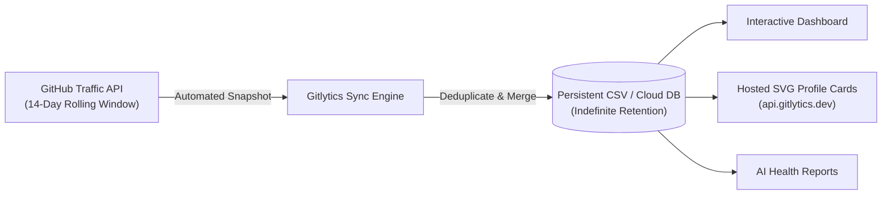

<div align="center">


# Gitlytics
### Next-Gen GitHub Traffic Intelligence, Dynamic SVG Widgets & Automation

[](https://pypi.org/project/gitlytics/)
[](https://www.python.org/) <!-- Python-3.11+ -->
[](LICENSE)
[](https://fastapi.tiangolo.com/)
[](https://react.dev/)
[](https://dashboard.gitlytics.dev)
[](https://docs.gitlytics.dev)

<br/>

**The complete developer analytics suite for GitHub.**  
Bypass GitHub's 14-day traffic cliff, track stargazer trajectories, and launch a local or self-hosted analytics dashboard in seconds.

> **What ships in the `pip install gitlytics` wheel:** the CLI, the Python SDK, and the local/self-hosted React dashboard. The **SVG profile cards and tech-badge renderer is a separate hosted service** at [`api.gitlytics.dev`](https://api.gitlytics.dev) - the package does not contain a card generator. See [Ecosystem & Links](#-ecosystem--links).

[**Explore Live Dashboard**](https://dashboard.gitlytics.dev) • [**Read the Docs**](https://docs.gitlytics.dev) • [**Engineering Blog**](https://blog.gitlytics.dev) • [**GitHub Action**](https://github.com/ameyachopade/gitlytics-github-traffic-automation)

<br/>

</div>

---

## ⚡ Highlights at a Glance

| Feature | Description |
| :--- | :--- |
| **🚨 14-Day Limit Defeated** | Automatically snapshot & merge repository views, clones, referrers, and paths indefinitely. |
| **📈 Stargazer Trajectories** | Real-time cumulative star growth tracking and milestone timeline projections. |
| **🤖 AI Health Scorecards** | Cloud AI diagnostics analyzing commit velocity, issue health, PR turnaround, and traffic surges. |
| **💻 CLI, Python SDK & Web UI** | Use it as a terminal command, import it into Python pipelines, or self-host the full React studio. |
| **🎨 Hosted SVG Cards & Logos** | The hosted service at [`api.gitlytics.dev`](https://api.gitlytics.dev) renders 31 profile-card slugs in 33 high-contrast themes, plus 181 tech-logo capsules. Not part of the pip package. |

---

## 🎨 Hosted Profile Cards & Widgets

> **Hosted service, not the pip package.** The card and logo renderer below is served by the Gitlytics cloud API at [`api.gitlytics.dev`](https://api.gitlytics.dev). The `gitlytics` wheel you install from PyPI contains the traffic CLI, the Python SDK and the local dashboard - it does **not** contain an SVG card generator. Install the package for traffic analytics; embed the hosted URLs for cards.

Elevate your GitHub profile README with the Gitlytics hosted native, dynamic vector SVG rendering engine. All cards feature crisp typography, custom vector squircle icons, subtle gradient accents, and real-time GitHub GraphQL data.

### 🖼️ Featured Card Previews

<div align="center">
  <table border="0" width="100%">
    <tr>
      <td align="center" width="50%">
        <b>👤 Flagship Developer Profile Card</b> (Obsidian Slate)<br/>
        <sub>Avatar, bio, verified status, 4 metric squircles & top languages bar</sub><br/><br/>
        
      </td>
      <td align="center" width="50%">
        <b>⭐ Account Highlights 2A-2</b> (Tokyo Night)<br/>
        <sub>Top repository, primary language share, peak year & longevity badge</sub><br/><br/>
        
      </td>
    </tr>
    <tr>
      <td align="center" width="50%">
        <b>📊 Language Diversity Index</b> (Dracula)<br/>
        <sub>Radial diversity score gauge, repo share, byte volume & stack capsules</sub><br/><br/>
        
      </td>
      <td align="center" width="50%">
        <b>📈 Yearly Activity Matrix</b> (Nord)<br/>
        <sub>Commit velocity, issue resolutions, code reviews & contribution cadence</sub><br/><br/>
        
      </td>
    </tr>
  </table>
</div>

### 🚀 Instant Markdown Embed

Add any card to your GitHub `README.md` with a single line of Markdown:

```markdown
<!-- Replace 'yourusername' and choose your preferred theme -->

```

<details>
<summary><b>🔍 View All 31 Card Slugs (hosted service)</b></summary>

<br/>

| Category | Card Slug | Focus & Visual Hierarchy |
| :--- | :--- | :--- |
| **Flagship** | `profile-card` | Complete overview: Avatar, bio, followers, contributions, languages. |
| **Highlights** | `account-highlights` | Most active repo, primary language, account longevity milestones. |
| **Languages** | `language-diversity` | Radial language entropy score gauge + byte volume breakdowns. |
| **Cadence** | `weekly-cadence` | 7-day cyclical radar heatmap of commit & review activity. |
| **Productivity** | `productive-hours` | Circadian clock visualization showing peak coding hours. |
| **Velocity** | `commit-velocity` | High-frequency commit trendlines, averages, and momentum. |
| **Trajectory** | `star-journey` | Milestone progression towards star milestones. |
| **Reviews** | `review-stats` | PR reviews conducted, turnaround latency, and acceptance rate. |
| **Matrix** | `yearly-activity` | Comprehensive yearly breakdown of contributions by category. |
| **Impact** | `open-source-impact` | Ecosystem reach, community forks, and public issue closure rate. |

*...and 21 more specialized cards available in the [Interactive Embed Studio](https://dashboard.gitlytics.dev/widgets).*

</details>

<details>
<summary><b>🎨 Explore 33 Color Themes</b></summary>

<br/>

Supported theme values via `?theme=<name>`:

`default` • `dracula` • `tokyonight` • `nord` • `obsidian-gold` • `synthwave84` • `cyberpunk` • `catppuccin-mocha` • `gruvbox-dark` • `monokai` • `one-dark` • `solarized-dark` • `matrix` • `rose-pine` • `github-dark` • `github-light` • `material-ocean` • `emerald-dark` • `amber-minimal` • `slate-pro` • `ayu-dark` • `horizon` • `shades-of-purple` • `cobalt2` • `night-owl` • `palenight` • `laserwave` • `oceanic-next` • `dimmed` • `high-contrast`

</details>

---

### 🏷️ Hosted Multi-Source Tech Badges & Concept Capsules

> Served by the hosted service at [`api.gitlytics.dev`](https://api.gitlytics.dev) - 181 tech logos plus custom text-only capsules. Not part of the pip package.

Generate clean capsule badges for your tech stack. Supports official brand logos plus **custom text-only capsules** for advanced concepts:

```markdown
<!-- Official brand logo capsule -->


<!-- Custom text-only concept capsule -->

```

<div align="center">
  
  
  
  
  
</div>

---

## 🔄 How the Traffic Engine Works

GitHub only preserves **14 days of historical traffic data**. Gitlytics automates historical aggregation into an append-only archive:



### ⚡ Setup in Under 2 Minutes:
Use our pre-configured companion GitHub Action that runs automatically every 13 days to snapshot and backup your data:

👉 **[Deploy the Gitlytics GitHub Traffic Automation Action](https://github.com/ameyachopade/gitlytics-github-traffic-automation)**

---

## 📦 Installation

```bash
# Core CLI and Python Analytics Engine
pip install gitlytics

# Full Package (Includes React Dashboard Web Server)
pip install "gitlytics[dashboard]"
```

---

## 💻 CLI Quick Reference

```bash
# 1. Fetch live 14-day traffic and display formatted ASCII tables
gitlytics fetch --token "ghp_your_token" --print-table

# 2. Filter specific metrics (e.g., views, clones, referrers)
gitlytics fetch --token "ghp_your_token" --metrics views clones

# 3. Synchronize snapshots into local database
gitlytics sync --token "ghp_your_token" --data-dir "./data"

# 4. Schedule automatic sync as a background cron job (e.g. daily at 11 PM)
gitlytics sync --token "ghp_your_token" --data-dir "./data" --schedule-cron "0 23 * * *"

# 5. Launch the React + FastAPI web analytics studio
gitlytics dashboard

# 6. Retrieve cumulative stargazer trajectory for a repository
gitlytics stars owner/repo --token "ghp_your_token"
```

> **CLI output contract:** the traffic table and the success summary go to **stdout**; every error and warning goes to **stderr**. Exit codes are meaningful - `0` success, `1` runtime/upstream failure, `2` bad input - so `gitlytics fetch ... > out.csv` never mixes diagnostics into your data.

---

## 🐍 Native Python SDK

Incorporate Gitlytics directly into custom pipelines, Jupyter notebooks, or scheduled scripts:

```python
import gitlytics

# 1. Fetch traffic data as a pandas DataFrame or timeseries dict
df = gitlytics.fetch_traffic(
    token="ghp_your_token",
    return_format="dataframe"  # Options: "dataframe", "timeseries", "summary"
)

# 2. Sync snapshots and export consolidated dashboard JSON
gitlytics.sync(
    token="ghp_your_token",
    data_dir="./data",
    export_json="./data/export.json"
)

# 3. Query historical cumulative star trajectory
star_points = gitlytics.fetch_star_history(
    owner="ameyachopade",
    repo="gitlytics",
    token="ghp_your_token"
)

# 4. Programmatically serve the web studio on loopback with a pre-loaded token
gitlytics.serve_dashboard(
    host="127.0.0.1",
    port=8080,
    token="ghp_your_token",
    data_dir="./data"
)
```

---

## 📊 Database Schema (24 Daily Metrics)

Gitlytics stores normalized daily records in local CSV files or cloud storage:

| Column | Type | Description |
| :--- | :--- | :--- |
| `date` | `str` | ISO 8601 date string (`YYYY-MM-DD`). |
| `repository` | `str` | Full GitHub repository name (`owner/repo`). |
| `is_private` | `bool` | Privacy state of the repository. |
| `views` | `int` | Total page views recorded on this day. |
| `unique_visitors` | `int` | Unique visitors browsing the repository. |
| `clones` | `int` | Total git clone operations on this day. |
| `unique_cloners` | `int` | Distinct IP / client clone operations. |
| `stars` | `int` | Total cumulative stargazer snapshot count. |
| `forks` | `int` | Total cumulative fork count. |
| `releases` | `int` | Total repository release count snapshot. |
| `language` | `str` | Primary programming language. |
| `topics` | `str` | JSON array of repository tags and topics. |
| `watchers_count` | `int` | Total watcher count. |
| `pushed_at` | `str` | Last code push timestamp. |
| `created_at` | `str` | Repository creation timestamp. |
| `open_issues_count` | `int` | Total open issues snapshot. |
| `top_referrer` | `str` | Highest-volume external referral domain. |
| `top_referrer_views` | `int` | Total views attributed to top referrer. |
| `top_referrer_uniques` | `int` | Unique visitors attributed to top referrer. |
| `_raw_referrers` | `str` | Complete JSON breakdown of all referral channels. |
| `top_path` | `str` | Most frequently visited repository file/path. |
| `top_path_views` | `int` | Views attributed to the top path. |
| `top_path_uniques` | `int` | Unique visitors attributed to the top path. |
| `_raw_paths` | `str` | Complete JSON breakdown of all popular paths. |

---

## 🔗 Ecosystem & Links

- 📦 **[PyPI Package](https://pypi.org/project/gitlytics/)**: Official Python package distribution - the traffic CLI, the Python SDK and the local/self-hosted dashboard.
- 🌐 **[Live Dashboard](https://dashboard.gitlytics.dev)**: Production Web UI to explore widgets and inspect traffic.
- 🖼️ **[Hosted Card & Logo API](https://api.gitlytics.dev)**: Serves the 31 SVG profile-card slugs (33 themes) and 181 tech-logo capsules. This is a separate hosted service - it is **not** bundled in the `gitlytics` wheel.
- 📚 **[Documentation](https://docs.gitlytics.dev)**: Full API guides, card parameters, and self-hosting documentation.
- 📝 **[Engineering Blog](https://blog.gitlytics.dev)**: Architecture breakdowns, caching strategies, and performance benchmarks.
- ⚙️ **[Traffic Automation Action](https://github.com/ameyachopade/gitlytics-github-traffic-automation)**: Official GitHub Action companion.

---

## ⭐ Show Your Support

If Gitlytics has saved your repository data or elevated your profile, please consider giving the repository a **⭐ Star on [GitHub](https://github.com/ameyachopade/gitlytics)** - it helps the project grow!

---

## 📄 License

Distributed under **Apache License 2.0 + Commons Clause v1.0**. See [`LICENSE`](LICENSE) for full details.
