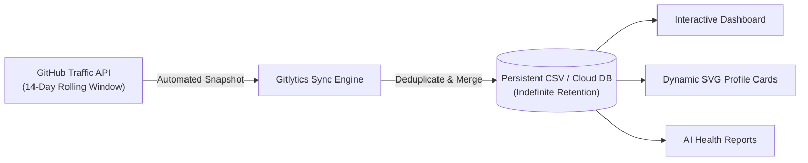

<div align="center">


# Gitlytics
### Next-Gen GitHub Traffic Intelligence, Dynamic SVG Widgets & Automation

[](https://pypi.org/project/gitlytics/)
[](https://www.python.org/)
[](LICENSE)
[](https://fastapi.tiangolo.com/)
[](https://react.dev/)
[](https://dashboard.gitlytics.dev)
[](https://docs.gitlytics.dev)

<br/>

**The complete developer analytics suite for GitHub.**  
Bypass GitHub's 14-day traffic cliff, generate 31+ ultra-modern vector SVG profile cards with 33 high-contrast themes, track stargazer trajectories, and launch a local or self-hosted analytics dashboard in seconds.

[**Explore Live Dashboard**](https://dashboard.gitlytics.dev) • [**Read the Docs**](https://docs.gitlytics.dev) • [**Engineering Blog**](https://blog.gitlytics.dev) • [**GitHub Action**](https://github.com/ameyachopade/gitlytics-github-traffic-automation)

<br/>

</div>

---

## ⚡ Highlights at a Glance

| Feature | Description |
| :--- | :--- |
| **🚨 14-Day Limit Defeated** | Automatically snapshot & merge repository views, clones, referrers, and paths indefinitely. |
| **📇 31+ Modern Profile Cards** | Pure vector SVG cards with custom icons, glassmorphism, responsive geometry, and zero dependencies. |
| **🎨 33 High-Contrast Themes** | Carefully tuned dark and light palettes (`default`, `dracula`, `tokyonight`, `nord`, `obsidian-gold`, `synthwave84`, etc.). |
| **🏷️ 200+ Tech Badges & Capsules** | Multi-color brand badges and text capsule tags for AI/ML methods, SRE architectures, and contact links. |
| **📈 Stargazer Trajectories** | Real-time cumulative star growth tracking and milestone timeline projections. |
| **🤖 AI Health Scorecards** | Cloud AI diagnostics analyzing commit velocity, issue health, PR turnaround, and traffic surges. |
| **💻 CLI, Python SDK & Web UI** | Use it as a terminal command, import it into Python pipelines, or self-host the full React studio. |

---

## 🎨 Ultra-Modern Profile Cards & Widgets

Elevate your GitHub profile README with Gitlytics' native, dynamic vector SVG rendering engine. All cards feature crisp typography, custom vector squircle icons, subtle gradient accents, and real-time GitHub GraphQL data.

### 🖼️ Featured Card Previews

<div align="center">
  <table border="0" width="100%">
    <tr>
      <td align="center" width="50%">
        <b>👤 Flagship Developer Profile Card</b> (Obsidian Slate)<br/>
        <sub>Avatar, bio, verified status, 4 metric squircles & top languages bar</sub><br/><br/>
        
      </td>
      <td align="center" width="50%">
        <b>✨ Account Highlights 2×2</b> (Tokyo Night)<br/>
        <sub>Top repository, primary language share, peak year & longevity badge</sub><br/><br/>
        
      </td>
    </tr>
    <tr>
      <td align="center" width="50%">
        <b>📊 Language Diversity Index</b> (Dracula)<br/>
        <sub>Radial diversity score gauge, repo share, byte volume & stack capsules</sub><br/><br/>
        
      </td>
      <td align="center" width="50%">
        <b>🍩 Top Languages by Code Size</b> (Nord)<br/>
        <sub>Authentic GitHub language colors, segmented donut ring & progress pills</sub><br/><br/>
        
      </td>
    </tr>
    <tr>
      <td align="center" width="50%">
        <b>📈 Issue Statistics & Annual Breakdown</b> (Obsidian Gold)<br/>
        <sub>Key issue metrics with full annual activity distribution bar chart</sub><br/><br/>
        
      </td>
      <td align="center" width="50%">
        <b>📁 Recently Updated Repositories</b> (Catppuccin Mocha)<br/>
        <sub>Elevated repo cards with language badges, star counts & relative timestamps</sub><br/><br/>
        
      </td>
    </tr>
  </table>
</div>

### 📋 Quick Embed Snippet

Add any card to your GitHub `README.md` with a single line of Markdown:

```markdown
<!-- Flagship Developer Profile Card -->
[](https://github.com/YOUR_USERNAME)

<!-- Account Highlights -->
[](https://github.com/YOUR_USERNAME)

<!-- Language Diversity Gauge -->
[](https://github.com/YOUR_USERNAME)
```

<details>
<summary><b>🔍 View All 31 Available Card Slugs</b></summary>

<br/>

| Category | Card Slug | Description |
| :--- | :--- | :--- |
| **Profile** | `profile-card` | **Flagship** developer profile summary with avatar, metrics & language bar |
| **Profile** | `profile-compact` | Sleek horizontal developer banner with avatar and core numbers |
| **Profile** | `profile-details` | Profile card with monthly contribution trendline curve |
| **Profile** | `stats` | General overview with GitHub Octocat watermark and stat rows |
| **Profile** | `github-age` | Account age, active milestones, and join date timeline |
| **Languages** | `most-commit-language` | Donut chart of languages by byte volume with authentic language colors |
| **Languages** | `repos-per-language` | Donut chart of repositories per language |
| **Languages** | `language-bars` | Horizontal distribution bars with repository count badges |
| **Languages** | `language-diversity` | Radial diversity score meter and 4-card ecosystem scorecard |
| **Activity** | `weekly-activity` | 7-day volume breakdown (Mon–Sun) with peak day highlight |
| **Activity** | `monthly-activity` | 12-month contribution distribution bars |
| **Activity** | `productive-time` | 24-hour commit rhythm with timezone offset and peak productivity hour |
| **Activity** | `contribution-streak` | Circular streak badge with flame icon, consistency meter & active days |
| **Repos** | `top-repos` | Elevated cards for top starred repositories with language & fork pills |
| **Repos** | `recent-repos` | Elevated cards for recently pushed repositories with relative time badges |
| **Repos** | `repo-breakdown` | Owned vs. forked repository ratio segmented visual bar |
| **Repos** | `repo-insights` | Velocity and engagement ratio across your public repository suite |
| **Contributions** | `commit-stats` | 4 commit metric cards + annual commit breakdown bar chart |
| **Contributions** | `pr-stats` | 4 PR metric cards + annual pull request activity bar chart |
| **Contributions** | `issue-stats` | 4 issue metric cards + annual issue activity bar chart |
| **Contributions** | `review-stats` | 4 review metric cards + annual code review breakdown bar chart |
| **Contributions** | `combined-contributions` | Multi-segment donut chart comparing Commits, PRs, Issues, and Reviews |
| **Growth** | `year-comparison` | Year-over-year delta card (+32%) with dual comparison volume columns |
| **Growth** | `contribution-growth` | Smooth curved multi-year area growth chart with peak indicator dots |
| **Growth** | `milestone-progress` | Gamified progress tracker toward 1,000 commits, 100 PRs, 100 stars |
| **Growth** | `star-journey` | Star ranking bars for top repositories and average star velocity |
| **Growth** | `code-metrics` | Total codebase volume and multi-language storage breakdown |
| **Impact** | `social-impact` | Community forks, stars, and developer reach engagement card |
| **Impact** | `account-highlights` | 2×2 glass grid: Best repo, top language, peak year & account age |
| **Impact** | `open-source-impact` | Influence score and multi-stack open source contributions |
| **Impact** | `achievement-board` | 6 unlocked vs. locked GitHub achievement badge cards |

</details>

---

### 🏷️ Multi-Source Tech Badges & Concept Capsules

Generate clean capsule badges for your tech stack. Supports official brand logos plus **custom text-only capsules** for advanced concepts:

<div align="center">
  
  **Languages & Cloud Frameworks**<br/>
   &nbsp;
   &nbsp;
   &nbsp;
   &nbsp;
   &nbsp;
  
  
  <br/><br/>
  
  **AI/ML & Architecture Capsules**<br/>
   &nbsp;
   &nbsp;
   &nbsp;
   &nbsp;
  
  
  <br/><br/>
  
  **Connectors & Social**<br/>
   &nbsp;
   &nbsp;
   &nbsp;
   &nbsp;
  

</div>

---

## 🚨 Defeating GitHub's 14-Day Traffic Cliff

> **⚠️ Did you know?** GitHub automatically purges view, clone, and referrer traffic records **older than 14 days**. Once that window closes, historical metrics are gone forever.

Gitlytics eliminates this limitation through automated background synchronization:



### ⏱️ Setup in Under 2 Minutes:
Use our pre-configured companion GitHub Action that runs automatically every 13 days to snapshot and backup your data:

👉 **[Deploy the Gitlytics GitHub Traffic Automation Action](https://github.com/ameyachopade/gitlytics-github-traffic-automation)**

---

## 🛠️ Installation

```bash
# Core CLI and Python Analytics Engine
pip install gitlytics

# Full Package (Includes React Dashboard Web Server)
pip install "gitlytics[dashboard]"
```

---

## ⌨️ CLI Quick Reference

```bash
# 1. Fetch live 14-day traffic and display formatted ASCII tables
gitlytics fetch --token "ghp_your_token" --print-table

# 2. Filter specific metrics (e.g., views, clones, referrers)
gitlytics fetch --token "ghp_your_token" --metrics views clones

# 3. Synchronize snapshots into local database
gitlytics sync --token "ghp_your_token" --data-dir "./data"

# 4. Schedule automatic sync as a background cron job (e.g. daily at 11 PM)
gitlytics sync --token "ghp_your_token" --data-dir "./data" --schedule-cron "0 23 * * *"

# 5. Launch the React + FastAPI web analytics studio
gitlytics dashboard

# 6. Retrieve cumulative stargazer trajectory for a repository
gitlytics stars owner/repo --token "ghp_your_token"
```

---

## 🐍 Native Python SDK

Incorporate Gitlytics directly into custom pipelines, Jupyter notebooks, or scheduled scripts:

```python
import gitlytics

# 1. Fetch traffic data as a pandas DataFrame or timeseries dict
df = gitlytics.fetch_traffic(
    token="ghp_your_token",
    return_format="dataframe"  # Options: "dataframe", "timeseries", "summary"
)

# 2. Sync snapshots and export consolidated dashboard JSON
gitlytics.sync(
    token="ghp_your_token",
    data_dir="./data",
    export_json="./data/export.json"
)

# 3. Query historical cumulative star trajectory
star_points = gitlytics.fetch_star_history(
    owner="ameyachopade",
    repo="gitlytics",
    token="ghp_your_token"
)

# 4. Programmatically serve the web studio on a custom port
gitlytics.serve_dashboard(
    host="0.0.0.0",
    port=8080,
    token="ghp_your_token",
    data_dir="./data"
)
```

---

## 📊 Database Schema (23 Daily Metrics)

Gitlytics stores normalized daily records in local CSV files or cloud storage:

| Column | Type | Description |
| :--- | :--- | :--- |
| `date` | `str` | ISO 8601 date string (`YYYY-MM-DD`). |
| `repository` | `str` | Full GitHub repository name (`owner/repo`). |
| `is_private` | `bool` | Privacy state of the repository. |
| `views` | `int` | Total page views recorded on this day. |
| `unique_visitors` | `int` | Unique visitors browsing the repository. |
| `clones` | `int` | Total git clone operations on this day. |
| `unique_cloners` | `int` | Distinct IP / client clone operations. |
| `stars` | `int` | Total cumulative stargazer snapshot count. |
| `forks` | `int` | Total cumulative fork count. |
| `language` | `str` | Primary programming language. |
| `topics` | `str` | JSON array of repository tags and topics. |
| `watchers_count` | `int` | Total watcher count. |
| `pushed_at` | `str` | Last code push timestamp. |
| `created_at` | `str` | Repository creation timestamp. |
| `open_issues_count` | `int` | Total open issues snapshot. |
| `top_referrer` | `str` | Highest-volume external referral domain. |
| `top_referrer_views` | `int` | Total views attributed to top referrer. |
| `top_referrer_uniques` | `int` | Unique visitors attributed to top referrer. |
| `_raw_referrers` | `str` | Complete JSON breakdown of all referral channels. |
| `top_path` | `str` | Most frequently visited repository file/path. |
| `top_path_views` | `int` | Views attributed to the top path. |
| `top_path_uniques` | `int` | Unique visitors attributed to the top path. |
| `_raw_paths` | `str` | Complete JSON breakdown of all popular paths. |

---

## 🔗 Ecosystem & Links

- 🌐 **[Live Dashboard](https://dashboard.gitlytics.dev)**: Production Web UI to explore widgets and inspect traffic.
- 📚 **[Documentation](https://docs.gitlytics.dev)**: Full API guides, card parameters, and self-hosting documentation.
- 📝 **[Engineering Blog](https://blog.gitlytics.dev)**: Architecture breakdowns, caching strategies, and performance benchmarks.
- ⚙️ **[Traffic Automation Action](https://github.com/ameyachopade/gitlytics-github-traffic-automation)**: Official GitHub Action companion.
- 📦 **[PyPI Package](https://pypi.org/project/gitlytics/)**: Official Python package distribution.

---

## 🌟 Show Your Support

If Gitlytics has saved your repository data or elevated your profile, please consider giving the repository a **⭐ Star on [GitHub](https://github.com/ameyachopade/gitlytics)** — it helps the project grow!

---

## 📄 License

Distributed under the **Apache License 2.0**. See [`LICENSE`](LICENSE) for full details.
