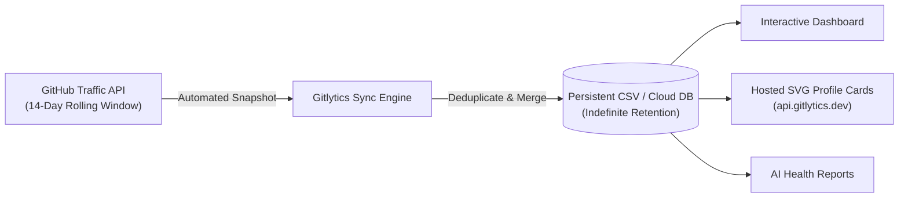

<div align="center">


# Gitlytics
### Git Intelligence for Teams & AI Agents - Telemetry, Local `.git` Analysis, MCP & Widgets

[](https://www.python.org/) <!-- Python-3.11+ -->
[](https://fastapi.tiangolo.com/)
[](https://react.dev/)
[](https://github.com/ameyachopade/gitlytics-github-traffic-automation)

<br/>

**Git Intelligence for Teams & AI Agents.**  
Archive repository traffic past the 14-day cliff, run 100% offline pure-Git engineering audits (`gitlytics analyze .`), serve live telemetry to coding agents over MCP, and launch the unified local dashboard in seconds.

> **What ships in the `pip install gitlytics` wheel:** the CLI (including `gitlytics analyze .` and `gitlytics mcp`), the Python SDK, and the unified local React dashboard. The **hosted SVG and 2x PNG profile cards, charts, and tech-badge renderer is a separate hosted service** at [`api.gitlytics.dev`](https://api.gitlytics.dev) - the wheel does not contain a card generator. See [The Gitlytics Ecosystem](#-the-gitlytics-ecosystem).

<!-- GITLYTICS:ECOSYSTEM_BADGES:START -->
[](https://pypi.org/project/gitlytics/)
[](https://www.npmjs.com/package/@gitlytics/cli)
[](LICENSE)
[](https://skills.sh/ameyachopade/gitlytics-plugin)
[](https://docs.gitlytics.dev/mcp)

<br/>

[](https://gitlytics.dev)
[](https://dashboard.gitlytics.dev)
[](https://widgets.gitlytics.dev)
[](https://docs.gitlytics.dev)
[](https://blog.gitlytics.dev)
<!-- GITLYTICS:ECOSYSTEM_BADGES:END -->

<br/>

</div>

---

## ⚡ Highlights at a Glance

| Feature | Description |
| :--- | :--- |
| **🚨 14-Day Limit Defeated** | Automatically snapshot & merge repository views, clones, referrers, and paths indefinitely. |
| **📈 Stargazer Trajectories** | Real-time cumulative star growth tracking and milestone timeline projections. |
| **🤖 AI Health Scorecards** | Cloud AI diagnostics analyzing commit velocity, issue health, PR turnaround, and traffic surges. |
| **💻 CLI, Python SDK & Web UI** | Use it as a terminal command, import it into Python pipelines, or self-host the full React studio. |
| **🎨 Hosted SVG Cards & Logos** | The hosted service at [`api.gitlytics.dev`](https://api.gitlytics.dev) renders 50 profile-card slugs in 50 unified themes across 20 visual styles, plus 200 tech-logo capsules. Not part of the pip package. |
| **🔌 MCP Server & Agent Skills** | Connect AI agents via 1-click OAuth ([`api.gitlytics.dev/mcp-oauth`](https://api.gitlytics.dev/mcp-oauth)), zero-login public mode ([`api.gitlytics.dev/mcp`](https://api.gitlytics.dev/mcp)), offline stdio (`gitlytics mcp`), or 4 skills via `npx skills add ameyachopade/gitlytics-plugin -g`. |

---

## 🎨 Hosted Profile Cards & Widgets

> **Hosted service, not the pip package.** The card and logo renderer below is served by the Gitlytics cloud API at [`api.gitlytics.dev`](https://api.gitlytics.dev). The `gitlytics` wheel you install from PyPI contains the traffic CLI, the Python SDK and the local dashboard - it does **not** contain an SVG card generator. Install the package for traffic analytics; embed the hosted URLs for cards.

Elevate your GitHub profile README with the Gitlytics hosted native, dynamic vector SVG rendering engine. All cards feature crisp typography, custom vector squircle icons, subtle gradient accents, and real-time GitHub GraphQL data.

### 🖼️ Featured Card Previews

<div align="center">

**👤 Flagship Developer Profile Card** (`default` - Obsidian Slate)  
<sub>Avatar, bio, verified status, 4 metric squircles & top languages bar</sub>


<br/>

**⭐ Account Highlights** (`tokyonight` - Tokyo Night)  
<sub>Top repository, primary language share, peak year & longevity badge</sub>


<br/>

**📊 Language Diversity Index** (`dracula` - Dracula)  
<sub>Language diversity score, primary share, byte volume & stack breadth</sub>


<br/>

**📈 All Contributions** (`nord` - Nord)  
<sub>Commits, pull requests, issues & code reviews combined</sub>


</div>

### 🚀 Instant Markdown Embed

Add any card to your GitHub `README.md` with a single line of Markdown:

```markdown
<!-- Replace 'yourusername' and choose your preferred theme -->

```

<details>
<summary><b>🔍 View All 50 Card Slugs (hosted service)</b></summary>

<br/>

| Category | Card Slug | Focus & Visual Hierarchy |
| :--- | :--- | :--- |
| **Flagship** | `profile-card` | Complete overview: Avatar, bio, followers, contributions, languages. |
| **Highlights** | `account-highlights` | Most active repo, primary language, account longevity milestones. |
| **Languages** | `language-diversity` | Radial language entropy score gauge + byte volume breakdowns. |
| **Cadence** | `weekly-cadence` | 7-day cyclical radar heatmap of commit & review activity. |
| **Productivity** | `productive-hours` | Circadian clock visualization showing peak coding hours. |
| **Velocity** | `commit-velocity` | High-frequency commit trendlines, averages, and momentum. |
| **Trajectory** | `star-journey` | Milestone progression towards star milestones. |
| **Reviews** | `review-stats` | PR reviews conducted, turnaround latency, and acceptance rate. |
| **Contributions** | `combined-contributions` | Commits, pull requests, issues & code reviews combined. |
| **Impact** | `open-source-impact` | Ecosystem reach, community forks, and public issue closure rate. |

*...and 40 more specialized cards available in the [Interactive Embed Studio](https://widgets.gitlytics.dev).*

</details>

<details>
<summary><b>🎨 Explore 50 Unified Color Themes</b></summary>

<br/>

Supported theme values via `?theme=<name>` (plus 20 visual variants via `?variant=<name>`):

`default` • `gitlytics-dark` • `dracula` • `tokyonight` • `nord` • `obsidian-gold` • `synthwave84` • `cyberpunk` • `catppuccin-mocha` • `gruvbox-dark` • `monokai` • `one-dark` • `solarized-dark` • `matrix` • `rose-pine` • `github-dark` • `github-light` • `material-ocean` • `emerald-dark` • `amber-minimal` • `slate-pro` • `ayu-dark` • `horizon` • `shades-of-purple` • `cobalt2` • `night-owl` • `palenight` • `laserwave` • `oceanic-next` • `dimmed` • `high-contrast` *(and 19 more in the [Embed Studio](https://widgets.gitlytics.dev))*

</details>

---

### 🏷️ Hosted Multi-Source Tech Badges & Concept Capsules

> Served by the hosted service at [`api.gitlytics.dev`](https://api.gitlytics.dev) - 200 verified tech logos plus custom text-only capsules. Not part of the pip package.

Generate clean capsule badges for your tech stack. Supports official brand logos plus **custom text-only capsules** for advanced concepts:

```markdown
<!-- Official brand logo capsule -->


<!-- Custom text-only concept capsule -->

```

<div align="center">
  
  
  
  
  
</div>

---

## 🔄 How the Traffic Engine Works

GitHub only preserves **14 days of historical traffic data**. Gitlytics automates historical aggregation into an append-only archive:



### ⚡ Setup in Under 2 Minutes:
Use our pre-configured companion GitHub Action that runs automatically every 13 days to snapshot and backup your data:

👉 **[Deploy the Gitlytics GitHub Traffic Automation Action](https://github.com/ameyachopade/gitlytics-github-traffic-automation)**

---

## 📦 Installation

```bash
# Core CLI and Python Analytics Engine
pip install gitlytics

# Full Package (Includes React Dashboard Web Server)
pip install "gitlytics[dashboard]"

# Optional Local Stdio MCP Extra (for offline CSV vaults + SDK access from AI agents)
pip install "gitlytics[mcp]"
```

---

## 💻 CLI Quick Reference

```bash
# 1. Fetch live 14-day traffic and display formatted ASCII tables
gitlytics fetch --token "ghp_your_token" --print-table

# 2. Filter specific metrics (e.g., views, clones, referrers)
gitlytics fetch --token "ghp_your_token" --metrics views clones

# 3. Synchronize snapshots into local database
gitlytics sync --token "ghp_your_token" --data-dir "./data"

# 4. Schedule automatic sync as a background cron job (e.g. daily at 11 PM)
gitlytics sync --token "ghp_your_token" --data-dir "./data" --schedule-cron "0 23 * * *"

# 5. Launch the React + FastAPI web analytics studio (loopback 127.0.0.1 by default)
gitlytics dashboard

# 5b. Bind to a non-loopback interface (requires explicit --public-bind; disables pre-loaded tokens)
gitlytics dashboard --host 0.0.0.0 --public-bind

# 6. Retrieve cumulative stargazer trajectory for a repository
gitlytics stars owner/repo --token "ghp_your_token"

# 7. Start the local stdio MCP server (reads GITLYTICS_TOKEN from env; CSV vault works offline)
gitlytics mcp --data-dir "./data"
```

> **CLI output contract:** the traffic table and the success summary go to **stdout**; every error and warning goes to **stderr**. Exit codes are meaningful - `0` success, `1` runtime/upstream failure, `2` bad input - so `gitlytics fetch ... > out.csv` never mixes diagnostics into your data.
> **Dashboard security:** `gitlytics dashboard` binds to `127.0.0.1` by default, does not promote ambient `GITHUB_TOKEN` automatically, and disables `--token`/`GITLYTICS_TOKEN` on `--public-bind` so remote users must authenticate with their own token. See [`SECURITY.md`](SECURITY.md) for details.

---

## 🐍 Native Python SDK

Incorporate Gitlytics directly into custom pipelines, Jupyter notebooks, or scheduled scripts:

```python
import gitlytics

# 1. Fetch traffic data as a pandas DataFrame or timeseries dict
df = gitlytics.fetch_traffic(
    token="ghp_your_token",
    return_format="dataframe"  # Options: "dataframe", "timeseries", "summary"
)

# 2. Sync snapshots and export consolidated dashboard JSON
gitlytics.sync(
    token="ghp_your_token",
    data_dir="./data",
    export_json="./data/export.json"
)

# 3. Query historical cumulative star trajectory
star_points = gitlytics.fetch_star_history(
    owner="ameyachopade",
    repo="gitlytics",
    token="ghp_your_token"
)

# 4. Programmatically serve the web studio on loopback with a pre-loaded token
gitlytics.serve_dashboard(
    host="127.0.0.1",
    port=8080,
    token="ghp_your_token",
    data_dir="./data"
)
```

---

## 🔌 MCP Server & AI Agents

Connect **Antigravity**, **Claude Code**, **Cursor**, **Windsurf**, **VS Code**, **Codex**, and **OpenCode** directly to Gitlytics via the Model Context Protocol (`2025-03-26` Streamable HTTP) or local offline stdio.

### 1. Hosted Cloud MCP (Zero Local Install)

| Endpoint | Auth Mode | Tools Unlocked |
| :--- | :--- | :--- |
| **`https://api.gitlytics.dev/mcp-oauth`** | 1-click OAuth 2.1 + PKCE sign-in in IDEs | All 9 tools (5 public widget/profile/star tools + 4 private workspace traffic & AI health tools) |
| **`https://api.gitlytics.dev/mcp`** | Zero-login public mode (or optional `Bearer glt_live_...` API key for CI/CD) | 5 public tools immediately with zero login; 9 tools when passing an API key from [dashboard.gitlytics.dev/integrations](https://dashboard.gitlytics.dev/integrations) |

```json
{
  "mcpServers": {
    "gitlytics": {
      "type": "http",
      "url": "https://api.gitlytics.dev/mcp-oauth"
    }
  }
}
```

### 2. Local Offline Stdio MCP (Ships in This Package)

Query local `traffic_*.csv` archives and run `fetch`/`sync`/`stars`/`build_widget_embed` without touching Gitlytics Cloud:

```bash
pip install "gitlytics[mcp]"
export GITLYTICS_TOKEN="ghp_your_token"   # optional for offline CSV queries
gitlytics mcp --data-dir ./data
```

Using Node.js instead? Run the zero-dependency companion: `npx -y @gitlytics/cli mcp --mode local --data-dir ./data`.

### 3. Install Official Agent Skills (`skills.sh`)

```bash
npx skills add ameyachopade/gitlytics-plugin -g
```

See the [MCP & AI Agents Docs](https://docs.gitlytics.dev/mcp) for full client configs and tool schemas.

---

## 📊 Database Schema (24 Daily Metrics)

Gitlytics stores normalized daily records in local CSV files or cloud storage:

| Column | Type | Description |
| :--- | :--- | :--- |
| `date` | `str` | ISO 8601 date string (`YYYY-MM-DD`). |
| `repository` | `str` | Full GitHub repository name (`owner/repo`). |
| `is_private` | `bool` | Privacy state of the repository. |
| `views` | `int` | Total page views recorded on this day. |
| `unique_visitors` | `int` | Unique visitors browsing the repository. |
| `clones` | `int` | Total git clone operations on this day. |
| `unique_cloners` | `int` | Distinct IP / client clone operations. |
| `stars` | `int` | Total cumulative stargazer snapshot count. |
| `forks` | `int` | Total cumulative fork count. |
| `releases` | `int` | Total repository release count snapshot. |
| `language` | `str` | Primary programming language. |
| `topics` | `str` | JSON array of repository tags and topics. |
| `watchers_count` | `int` | Total watcher count. |
| `pushed_at` | `str` | Last code push timestamp. |
| `created_at` | `str` | Repository creation timestamp. |
| `open_issues_count` | `int` | Total open issues snapshot. |
| `top_referrer` | `str` | Highest-volume external referral domain. |
| `top_referrer_views` | `int` | Total views attributed to top referrer. |
| `top_referrer_uniques` | `int` | Unique visitors attributed to top referrer. |
| `_raw_referrers` | `str` | Complete JSON breakdown of all referral channels. |
| `top_path` | `str` | Most frequently visited repository file/path. |
| `top_path_views` | `int` | Views attributed to the top path. |
| `top_path_uniques` | `int` | Unique visitors attributed to the top path. |
| `_raw_paths` | `str` | Complete JSON breakdown of all popular paths. |

---

## 🔗 The Gitlytics Ecosystem

| Project | Role | Link |
| :--- | :--- | :--- |
| **[gitlytics](https://github.com/ameyachopade/gitlytics)** *(this repo)* | Core Python library, CLI (`fetch`, `sync`, `stars`, `dashboard`, `mcp`), and self-hosted local dashboard | [PyPI](https://pypi.org/project/gitlytics/) |
| **[gitlytics-npm](https://github.com/ameyachopade/gitlytics-npm)** | Zero-dependency Node.js CLI, JS/TS SDK, dual-mode MCP & local dashboard | [npm (`@gitlytics/cli`)](https://www.npmjs.com/package/@gitlytics/cli) |
| **[gitlytics-plugin](https://github.com/ameyachopade/gitlytics-plugin)** | Official Antigravity plugin, MCP configs & 4 Vercel Agent Skills | [skills.sh](https://skills.sh/ameyachopade/gitlytics-plugin) |
| **[gitlytics-github-traffic-automation](https://github.com/ameyachopade/gitlytics-github-traffic-automation)** | Composite GitHub Action for automated CSV traffic backups | [GitHub Action](https://github.com/ameyachopade/gitlytics-github-traffic-automation) |
| **Gitlytics Web & Docs** | Official Homepage, Docs Hub & Engineering Blog | [gitlytics.dev](https://gitlytics.dev) / [docs.gitlytics.dev](https://docs.gitlytics.dev) / [blog.gitlytics.dev](https://blog.gitlytics.dev) |
| **Gitlytics Cloud Dashboard** | Hosted Analytics Dashboard, Embed Studio & MCP OAuth Consent UI | [dashboard.gitlytics.dev](https://dashboard.gitlytics.dev) |
| **Gitlytics Hosted API & MCP** | 50-card / 200-logo SVG engine & Streamable HTTP MCP server (`/mcp-oauth` & `/mcp`) | [api.gitlytics.dev](https://api.gitlytics.dev) |

---

## 🤝 Contributing, Security & License

- **Contributing**: See [`CONTRIBUTING.md`](CONTRIBUTING.md) for local setup, test commands, and pull request guidelines.
- **Security**: See [`SECURITY.md`](SECURITY.md) for local security controls and private vulnerability reporting.
- **License**: Distributed under **Apache License 2.0 + Commons Clause v1.0**. See [`LICENSE`](LICENSE) for full details.

If Gitlytics has saved your repository data or elevated your profile, please consider giving the repository a **⭐ Star on [GitHub](https://github.com/ameyachopade/gitlytics)** - it helps the project grow!
